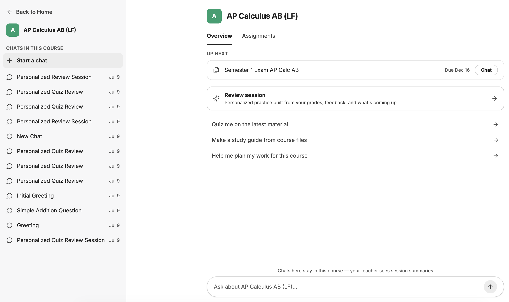

<p align="center">
  
</p>

<h1 align="center">CourseWing</h1>

<p align="center">
  An AI tutor and teacher console built into each student's real classes.
</p>

<p align="center">
  <a href="https://coursewing.org">Website</a> ·
  <a href="https://app.coursewing.org">App</a> ·
  <a href="https://coursewing.org/demo/teacher">Teacher console demo</a> (sample class, no account needed)
</p>

CourseWing syncs a student's Canvas or Google Classroom courses, then works through their actual assignments with them, using questions and small hints so the student does the thinking. Teachers get a console inside each course that shows where every student is strong, where they're stuck, and what to reteach tomorrow.

Built by Saaj Bhatia for the 2026 Congressional App Challenge (WA-8).

<p align="center">
  
</p>

## What it does

**For students**
- **Synced coursework:** every course from Canvas or Google Classroom, with assignments, due dates, grades, rubric feedback, mastery outcomes, announcements and course files.
- **A tutor that reads the course:** six tools search and quote course materials mid-conversation, and every answer marks what came from the course.
- **Study plans and review sessions:** a day-by-day plan around real deadlines, and review sessions that start from the teacher's review sheet and the topics where points were lost.
- **Learning profile:** remembers each student's strengths, struggles and goals across sessions.

**For teachers**
- **Class pulse and session summaries:** after each session, a short summary of what clicked and where the student struggled, rolled up into a class view.
- **Student profiles:** what each student is doing well and where they need help.
- **Class assistant:** ask "What should I focus on tomorrow?" and it names the most common mistake, who needs a check-in, and how to reteach it.
- **Help levels:** Open, Guided or Socratic per assignment, enforced by the server on every message.
- **Privacy by design:** teachers see summaries by default; a full chat opens only when a session is flagged, and every unlock is logged.

## How it works

```
Student / teacher (React + TypeScript)
        │
        ▼
Node + Express API ── CourseWing middleware adds the teacher's rules, the student's
        │             learning profile and the tutor policy to every request
        ▼
Claude agent loop ── six CourseWing tools ──► sync service (TypeScript + SQLite)
        │                                          ▲
        │                                          └── Canvas / Google Classroom
        ▼
Session summaries (Claude Haiku) ──► MongoDB ──► teacher console
```

## Where the CourseWing code lives

| Path | What it does |
|---|---|
| `api/server/middleware/coursewing.js` | Builds each tutor request: course card, help-level policy, persona, teacher-assistant mode |
| `api/server/routes/coursewing.js` | Course, connection and onboarding APIs |
| `api/server/routes/teacher.js`, `api/server/services/CourseWingTeacher.js` | Teacher console: summaries, class pulse, review queue, help levels, activities |
| `api/server/services/CourseWing.js`, `CourseWingAuth.js` | Sync-service client and Canvas / Google Classroom sign-in |
| `packages/api/src/coursewing/` | The six tutor tools and the course card |
| `packages/data-provider/src/coursewing.ts` | Shared types and prompt markers |
| `client/src/components/CourseWing/` | Course page, teacher view, course panel |
| `client/src/components/Onboarding/` | Onboarding wizard and guided tour |

The Canvas and Google Classroom sync service (course data, file text extraction and search) lives in a separate repository.

**Stack:** React, TypeScript, Node.js, Express, MongoDB, SQLite, Claude models, Docker, Azure, Cloudflare.

## Built on LibreChat

CourseWing is built on [LibreChat](https://github.com/danny-avila/LibreChat), an open-source chat app (MIT license) that provides the chat interface, sign-in, model connections, the agent loop and memory. CourseWing adds the school layer on top: the LMS sync, the course tools, help levels, the teacher console and onboarding. LibreChat's own documentation is at [docs.librechat.ai](https://docs.librechat.ai).

## License

MIT. See [LICENSE](LICENSE); LibreChat's copyright notice is retained.
